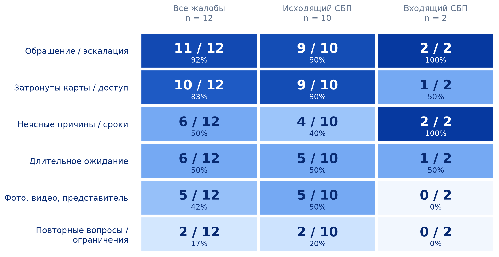
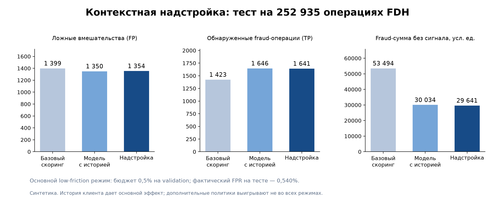

# TrustFlow — контекстная надстройка над антифродом

## Описание кейса

Данный репозиторий содержит решение бизнес-кейса ВТБ, посвящённого безопасности переводов через Систему быстрых платежей и клиентскому опыту при антифрод-проверках.

**Идея TrustFlow** — учитывать контекст операции и историю клиента, чтобы точнее выявлять подозрительные переводы и сокращать лишние вмешательства в обычные платежи.

Проект объединяет исследование проблемы, анализ клиентских жалоб, эксперименты с моделями и план банковского пилота.

### Ключевые исследования

В рамках проекта исследуется, как дополнительный контекст помогает антифроду различать мошеннические и обычные операции, какие затруднения испытывают клиенты при переводах и как оценивать эффект решения для банка и пользователей.

### Работа включает:

- анализ статистики Банка России по операциям через СБП;
- исследование отзывов и клиентских болей;
- локальный семантический поиск с помощью RuBERT-tiny2;
- разработку контекстной надстройки и сравнение моделей;
- проверку решения на синтетических данных FDH и PaySim;
- разработку метрик, протокола пилота и плана внедрения;
- построение сценарной финансовой модели.

В репозитории представлены материалы исследования, код анализа и обучения, сохранённые модели, визуализации и результаты экспериментов.

## Участники команды

- [Илья Матвеев](http://t.me/hep2014) — анализ данных, разработка pipeline, визуализация
- [Анастасия Кабанова](https://t.me/anastaness) — обучение модели
- [Мясников Евгений](https://t.me/Myzn1k) — дата-инжиниринг, разработка pipeline сбора данных
- [Профовичева Василиса](https://t.me/silshrsh) - аналитика данных, разработка продуктовых метрик

## Ключевые результаты

На **252 935 тестовых операциях FDH** контекстная надстройка показала следующий результат:

| Показатель | Базовая модель | TrustFlow |
|---|---:|---:|
| Обнаруженные мошеннические операции | 1 423 | **1 641** |
| Сумма мошеннических операций без сигнала, усл. ед. | 53 494,13 | **29 640,90** |
| Ложные вмешательства | 1 399 | **1 354** |

Основной вклад в улучшение внесла **история клиента**.

Результат получен в одном синтетическом эксперименте FDH с seed 0. 
## Шаги решения

Проект охватывает полный цикл работы — от исследования клиентской проблемы до экспериментальной проверки и оценки внедрения.

### 1. Исследование проблемы

На первом этапе была изучена статистика Банка России и собрана фактическая основа для оценки масштаба проблемы.

По данным ЦБ, объём операций без добровольного согласия клиентов через СБП по физическим лицам за II квартал 2026 года составил **2,741 млрд ₽ по всему рынку России**. Этот показатель характеризует рыночную проблему; он не является оценкой ущерба ВТБ или числа ложных отказов.

**Цель:** определить масштаб проблемы и сформировать проверяемые гипотезы.

### 2. Анализ клиентских болей

Для изучения клиентского опыта были проанализированы **338 текстов отзывов**. В них выделены 17 упоминаний СБП и 12 жалоб, вошедших в основную выборку.

На основе этой выборки были сгруппированы клиентские боли и построена карта их встречаемости.

**Цель:** понять, какие затруднения при переводах отражены в отзывах и какие сценарии стоит проверить в пилоте.


### 3. Семантический поиск в отзывах

Для поиска релевантных фрагментов использовалась локальная модель **RuBERT-tiny2**.

Модель выполнила семантическое ранжирование **532 текстовых окон**, помогая находить фрагменты для дальнейшего анализа.

**Цель:** упростить поиск клиентских сценариев в текстовых данных.


### 4. Разработка контекстной надстройки

Для экспериментальной проверки идеи была разработана модель, использующая дополнительные признаки операции и историю клиента.

В рамках этапа:

- подготовлены признаки и временные разбиения данных;
- обучены и откалиброваны модели LightGBM;
- подобраны пороги и правила принятия решений;
- сохранены модели, настройки и протоколы проверки.

Демонстрационный модуль возвращает решение **PASS / INTERVENE**, причину и оценки риска. Обязательные ограничения имеют приоритет над решением модели.

**Цель:** проверить, помогает ли контекст точнее выбирать операции для дополнительной проверки.


### 5. Сравнение подходов

Решение проверялось на двух синтетических наборах: **FDH и PaySim**.

Эксперимент FDH показал пользу клиентского контекста. 


### 6. План внедрения и банковского пилота

Для перехода от эксперимента к проверке в банковской среде подготовлены:

- этапы внедрения;
- состав команды, роли и загрузка;
- метрики и протокол оценки пилота;
- проектная смета.

Ориентир плана — **6 месяцев и 42,93 млн ₽**. Сроки и бюджет являются проектными оценками.

**Цель:** проверить качество решения на реальных данных и измерить его влияние на клиентский опыт.


### 7. Финансовая модель

Для оценки экономического потенциала подготовлена редактируемая сценарная модель.

Она позволяет рассматривать финансовый результат при разных предположениях и отделять потенциально сохранённые средства клиентов от прибыли банка.

**Цель:** оценить условия, при которых внедрение может быть экономически обоснованным.


## Описание технологического стека

- **Python 3.12**  
  Анализ данных, обучение моделей, применение решения и проверка результатов.

- **LightGBM**  
  Базовая и контекстная модели оценки риска операций.

- **RuBERT-tiny2**  
  Локальный семантический поиск по текстам клиентских отзывов.

- **JavaScript**  
  Расчётный модуль сценарной финансовой модели.

- **FDH и PaySim**  
  Синтетические данные для экспериментального сравнения подходов.

## Демонстрация графиков

### Карта клиентских болей

Распределение болей по 12 жалобам основной выборки.



### Сравнение моделей

Результаты экспериментального сравнения базового подхода и контекстной надстройки.



## Структура репозитория

```text
.
├── docs/                         # исследования и описание решения
│   ├── problem.md                # проблема, источники и клиентские боли
│   ├── architecture_and_metrics.md
│   │                             # архитектура, метрики и протокол пилота
│   ├── experiments.md            # результаты и ограничения экспериментов
│   ├── implementation.md         # план внедрения, команда и бюджет
│   ├── finance.md                # финансовая модель
│   └── reproduce.md              # инструкция по воспроизведению
│
├── assets/                       # графики и визуализации в PNG и SVG
│
├── models/
│   ├── context_layer/            # модели FDH, настройки и результаты
│   └── paysim_v2/                # модели и результаты PaySim
│
├── research/
│   ├── analysis/                 # статистика ЦБ, анализ жалоб и NLP
│   ├── paysim/
│   │   ├── audit/                # аудит первоначального эксперимента
│   │   └── v3/                   # проверка дополнительных экспертов
│   └── finance/                  # расчётный модуль и финансовые сценарии
│
├── scripts/                      # анализ, обучение и проверки
│
├── data/
│   ├── public_sources/           # сохранённые страницы ЦБ и их хеши
│   └── provenance/               # происхождение и условия использования данных
│
└── README.md                     # основное описание проекта
```

## Быстрый запуск

Сохранённые модели LightGBM включены в репозиторий и доступны для демонстрации без повторного обучения.

Для запуска потребуется Python 3.12. Команды выполняются из корня репозитория:

```powershell
python -m venv .venv
.\.venv\Scripts\python.exe -m pip install -r requirements.txt
.\.venv\Scripts\python.exe scripts/context_payment_layer.py --input models/context_layer/example_input.json
.\.venv\Scripts\python.exe scripts/verify_repository.py
```

По умолчанию используется режим `low_friction`: целевой FPR на validation — 0,5%, фактический FPR на тесте — 0,540%. Модуль оценивает входную операцию и не выполняет переводов.

В `models/context_layer/` сохранены модели `*_model.txt`, параметры калибровки `*_calibration.json`, описание 27 признаков `feature_manifest.json` и правила решения `selected_policies.json` и `low_friction_selection_lock.json`. Остальные JSON и CSV содержат результаты подбора, временные разбиения и проверки.
